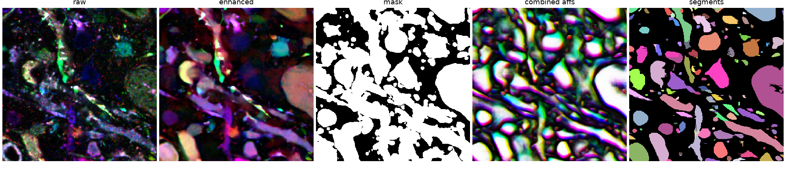
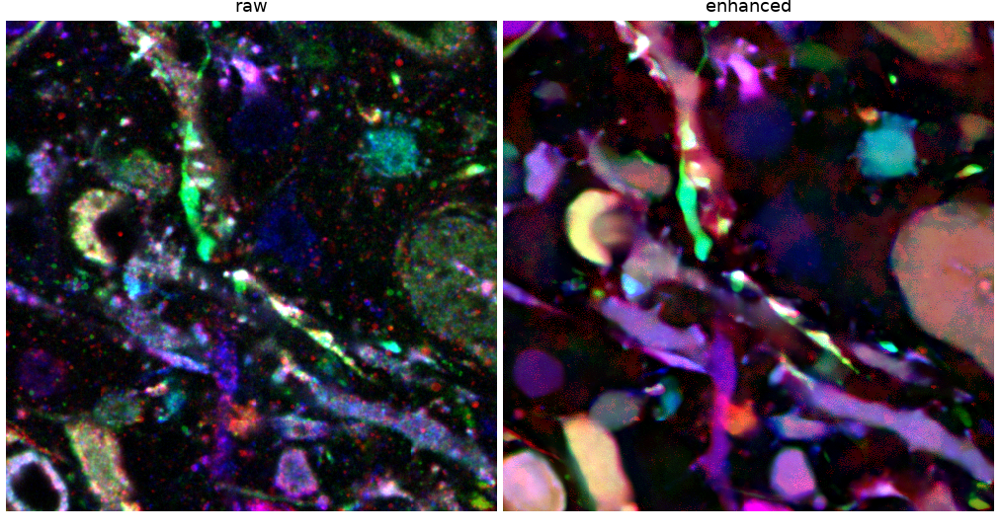
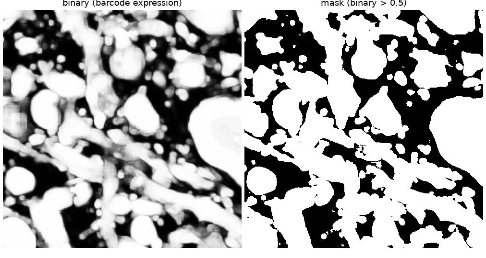
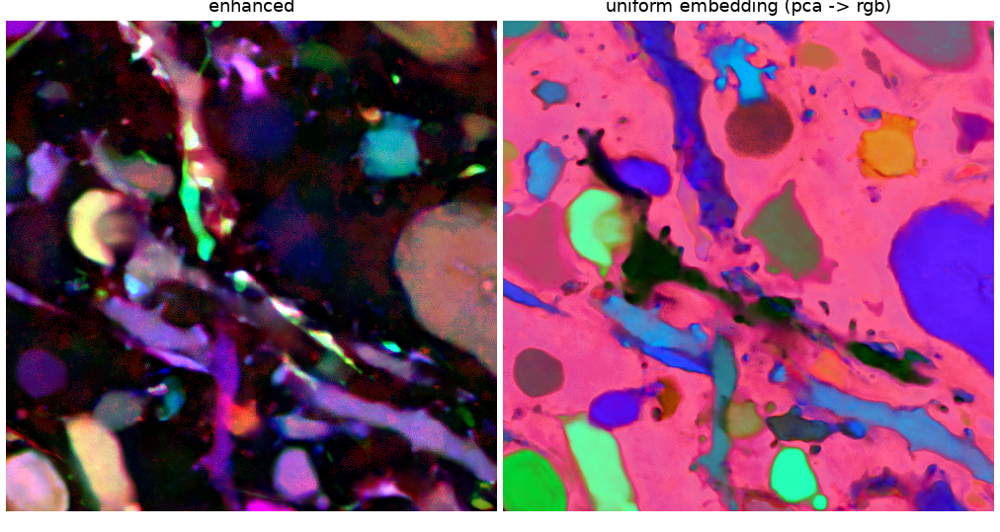
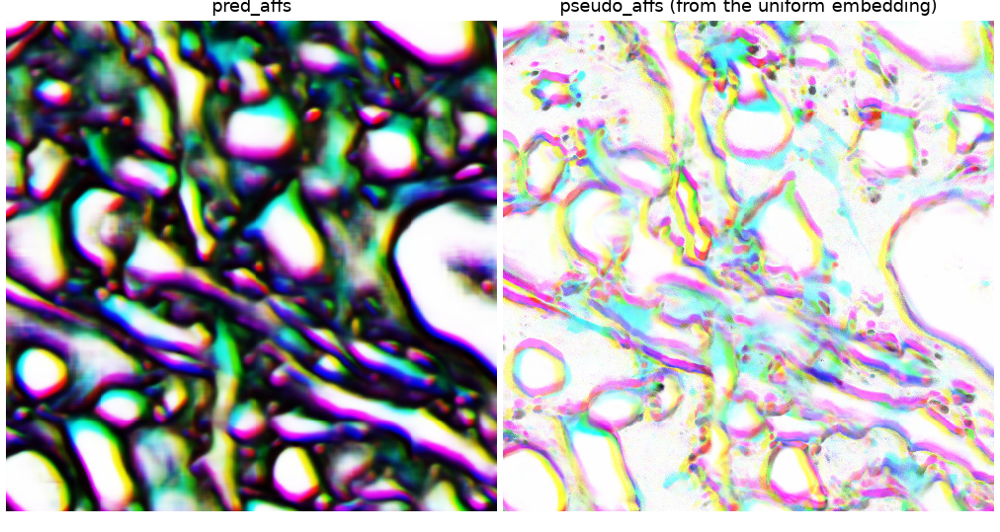
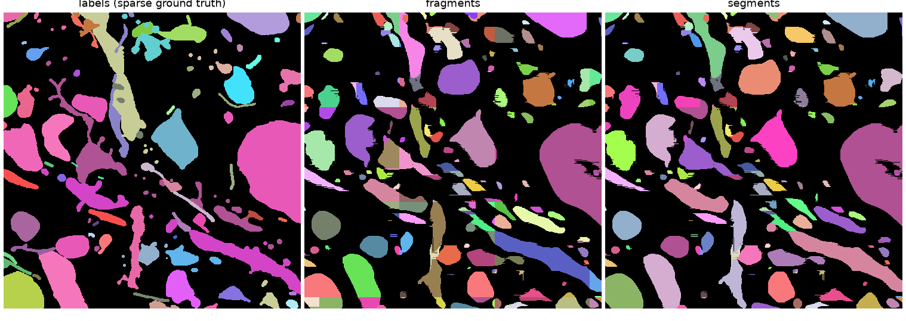
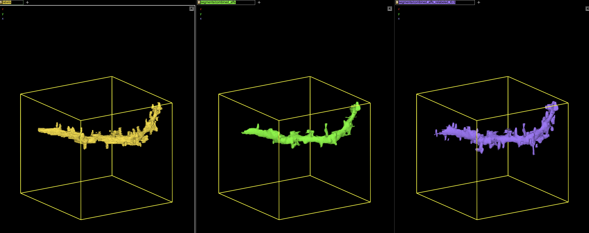
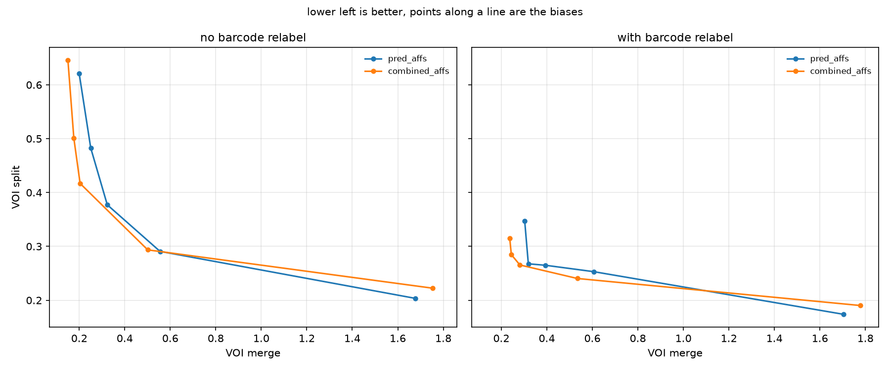
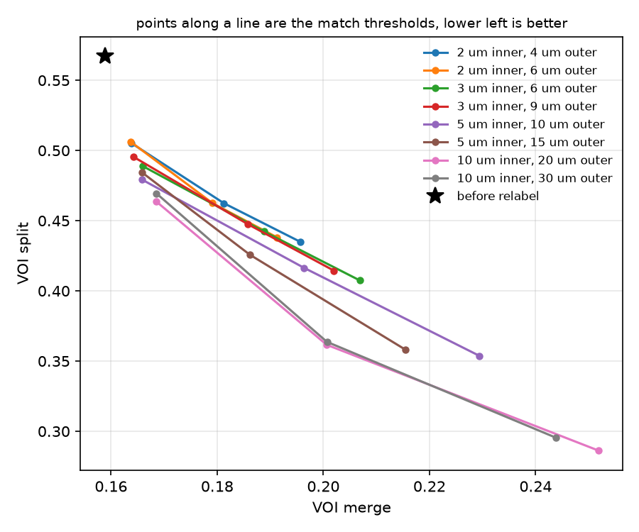

# prism_post
Example post processing scripts for the PRISM networks

## Overview

This is the follow up to
[prism_training](https://github.com/e11bio/prism_training). That repo shows how
example PRISM models are trained, this repo shows how to run them over a volume
and turn the outputs into a segmentation. For background on PRISM see the
[paper](https://www.biorxiv.org/content/10.1101/2025.09.26.678648v1) and [blog
post](https://www.e11.bio/blog/prism). Blockwise processing is done with
[volara](https://www.e11.bio/blog/volara).



We run four models over an example crop:

1. enhancement - cleans up the 18 raw barcode channels. Everything else uses
   this as input
2. barcode expression - is there any barcode signal in this voxel per channel?
   We threshold this into a mask so we don't make fragments out of background
3. affinities - 3 short range + 6 long range offsets
4. uniform embedding - maps each voxels barcode to a vector, where similar
   barcodes end up close together

The affinities know about boundaries, but can merge two touching neurons that
happen to have similar barcodes. The embedding doesn't know anything about
boundaries, but it does know which barcode a voxel has. So we turn the embedding
into "pseudo affinities" (how similar is a voxel to its neighbor along each
affinity offset?) and multiply the two together. An edge then has to look good
to both to survive.

After that we use a standard volara segmentation pipeline: extract fragments,
build a fragment graph, run global mutex watershed on it, and relabel. We keep
that segmentation split leaning on purpose, then use the barcodes to merge
pieces of the same neuron back together across gaps. Here we also score each
segmentation against the ground truth with simple labels based voi, so the
contribution of each step is visible.

Note - this is a simple example of the post processing, not the full evaluation
from the paper. The models were trained on this very crop, so the numbers here
say nothing about generalization, and we score with a plain in memory VOI
against the sparse labels. The labels were drawn inside this crop, so a neuron
that leaves and re-enters the crop has different ids on each piece, and when the
barcode relabel correctly bridges two such pieces it counts as a merge (only a
handful of cases here, `05_evaluate.py --gt-merge` shows the numbers without
them). Mutex watershed also improves with more context, so segmenting this small
crop directly might givv a somewhat worse result than segmenting a large volume
and cropping it down. The paper's evaluation ran on larger regions, with
skeleton ground truth and graph based metrics like expected run length and the
min cut metric, using more custom code. None of that is required to understand
the basic segmentation pipeline, which is what this repo is for.

## Getting started

> ## Pre-requisites
> We recommend using a package manager. The instructions assume [uv](https://docs.astral.sh/uv/getting-started/installation/).
>
> Tested on ubuntu 22.04 with an RTX 6000 gpu and 16 cpu workers. For an introduction to affinities and agglomeration see the [lsd](https://github.com/funkelab/lsd) tutorials.
---

1. clone this repo:
    ```
    git clone https://github.com/e11bio/prism_post.git
    cd prism_post
    uv sync
    ```

2. decide where data should go. Every script takes `--data-dir` and
   `--checkpoint-dir`, or you can set `PRISM_POST_DATA_DIR` and
   `PRISM_POST_CHECKPOINT_DIR` once. By default everything goes to `./data` and
   `./checkpoints`.
    ```
    export PRISM_POST_DATA_DIR=/some/path/data
    export PRISM_POST_CHECKPOINT_DIR=/some/path/checkpoints
    ```

3. download the example crop and checkpoints (~4gb)
    ```
    uv run python prism_post/data/download.py
    ```
   This gets the raw data and labels for one crop (`<data_dir>/sample.zarr`) and
   the weights for the four models (`<checkpoint_dir>/<model>/`). Everything the
   scripts produce also goes into `sample.zarr`:
    ```
    sample.zarr/
      raw, labels          downloaded
      predictions/         enhanced, binary, uniform, mask
      affs/                pred_affs, pseudo_affs, combined_affs
      fragments/<affs>     one per set of affinities you segment
      dbs/<affs>.sqlite    fragment graphs
      luts/<affs>.npz      fragment -> segment look up tables
      segments/<affs>      segmentations
      skeletons/<affs>.npz segment skeletons, used by the barcode relabel
      segments/sweep/      what the sweeps write
    ```

## Inference

Each model takes a minute or a few on one gpu. The scripts are in
`prism_post/inference/`, in order.

```
uv run python prism_post/inference/01_enhanced.py
uv run python prism_post/inference/02_binary.py
uv run python prism_post/inference/03_affs.py
uv run python prism_post/inference/04_uniform.py
```

Enhancement cleans up each barcode channel. All of the other models take the
enhanced data as input:



The barcode expression model gives a single channel (after taking the max across
channels); how likely is it that any barcode is expressed here. We threshold it
into a mask later:



The affinity model predicts 9 channels, 3 direct neighbors and 6 long range
offsets (see `NEIGHBORHOOD` in `config.py`). It also predicts lsds, which we
throw away here (they are useful for improving the affinities). The uniform
embedding is a 24 channel vector per voxel, shown here with pca to rgb. Note how
each neuron gets its own color and the embedding doesn't care about boundaries
at all:



## Post processing

Scripts are in `prism_post/post/`, again in order. The cpu steps take seconds to
a minute each.

1. threshold the barcode expression into a mask
    ```
    uv run python prism_post/post/01_mask.py
    ```

2. cosine similarity of the embedding along each affinity offset gives us pseudo
   affinities, then multiply them with the predicted affinities
    ```
    uv run python prism_post/post/02_pseudo_affs.py
    uv run python prism_post/post/03_combine_affs.py
    ```
   Shown with the three medium range offsets as rgb. The pseudo affinities are
   high almost everywhere (two voxels of the same neuron look the same), they
   only drop where the barcode actually changes. The product looks much like the
   predicted affinities, the main difference is that edges between neighbors
   with different barcodes are removed:

   

3. segment. This runs the four volara stages: fragments by mutex watershed in
   each block (affinities outside the mask are ignored), a fragment graph scored
   with mean affinities, a global mutex watershed on that graph, and a relabel
    ```
    uv run python prism_post/post/04_segment.py --affs combined_affs
    ```
   It is worth also segmenting the predicted affinities on their own, to see
   what the pseudo affinities contribute:
    ```
    uv run python prism_post/post/04_segment.py --affs pred_affs
    ```
   The fragments show the block structure of the blockwise watershed, the global
   step then joins them into segments:

   

4. relabel with barcodes. This is the PRISM specific step. The segmentation
   above is split leaning on purpose, so a neuron that crosses a weak section or
   an affinity gap ends up in pieces. The pieces still carry the same barcode
   though, so we skeletonize the segments, compute each segment's mean barcode,
   find segments whose skeleton endpoints are close together, and merge the ones
   whose barcodes agree
    ```
    uv run python prism_post/post/07_barcode_relabel.py --affs combined_affs
    ```
   By default two segments are candidates if they have skeleton endpoints within
   10 um of each other, and segments within 30 um whose barcodes disagree get a
   repulsive edge so a merge can't chain through them. Those are the paper's
   radii, in the zarr's coordinate frame, i.e. microns of expanded tissue (with
   5-6x expansion, 10 um is about 2 um biologically). This crop is only about 80
   um across, so there is no point going much larger here, and the number of
   endpoint pairs grows roughly with the cube of the radius so it also gets
   slow.

   The relabel is hard to see in a 2d slice, so here is one neuron in
   neuroglancer. Left is the ground truth label, middle the segment that
   overlaps it most in the base segmentation, right the same segment after the
   barcode relabel. The spines that were split off as separate segments are back
   on the dendrite:

   

   Skeletonizing is the slow part (about a minute here) and gets cached,
   everything after it takes seconds.

## Evaluation

```
uv run python prism_post/post/05_evaluate.py
```

For each segmentation this reports variation of information (voi_split goes up
when one neuron is split into several segments, voi_merge when one segment
covers several neurons, lower is better), how much of the labelled tissue is
covered by a segment at all, and plain counts of false merges and false splits.
On this crop:

|                          | voi split | voi merge | voi sum | covered | merges | splits |
|--------------------------|-----------|-----------|---------|---------|--------|--------|
| pred_affs                | 0.550     | 0.229     | 0.779   | 0.847   | 412    | 1479   |
| combined_affs            | 0.567     | 0.159     | 0.726   | 0.842   | 417    | 1651   |
| combined_affs_relabeled  | 0.295     | 0.244     | 0.539   | 0.842   | 516    | 738    |

The pseudo affinities mainly reduce merges, and the barcode relabel then halves
the number of splits. Unassigned voxels (about 15% of the labelled tissue here,
where all direct affinities are too low to make a fragment) are left out of VOI
and reported as coverage instead, otherwise they would score as one giant merge.
See `prism_post/evaluate.py`.

Two cheap sweeps show the tradeoffs. The global mutex watershed bias trades
splits for merges, and the relabel's radius and threshold do the same one step
later. Both reuse everything slow and only rerun the fast steps:

```
uv run python prism_post/post/06_sweep.py --relabel
uv run python prism_post/post/07_barcode_relabel.py --affs combined_affs --sweep
```



Solid lines are the segmentations at each bias, dashed lines the same with the
barcode relabel on top (`--relabel`, this skeletonizes each one so it takes a
minute per bias). Lower left is better. Two things to take from it: the relabel
removes far more splits than any bias can without a large increase in merges,
and it keeps the merge advantage of the combined affinities. Once the bias
becomes merge leaning, merges increase sharply with or without the relabel,
which is why we start from a split leaning segmentation.



The relabel's own sweep, each line is a pair of radii and the points along it
are the match thresholds. Results go to `sweep.csv` / `relabel_sweep.csv` in the
data dir. `--write` on the relabel sweep also writes every combination to
`segments/sweep/` so you can look at them.

## Having a look

With the vis extra installed (`uv sync --extra vis`) you can open any of the
datasets in neuroglancer:

```
uv run python prism_post/view.py                                   # everything
uv run python prism_post/view.py raw predictions/enhanced labels   # or just some
uv run python prism_post/view_sweep.py                             # base segmentation vs all the relabel variants
```

The barcode layers (raw, enhanced) get a slider and checkbox per channel, a seed
slider that shuffles which channel gets which color (useful for telling
neighbors apart), and contrast / brightness. Affinities are shown as rgb on the
medium range offsets.

Every blockwise task picks up where it left off, so if a run is interrupted you
can rerun the script. To recompute something from scratch, delete the output
dataset (plus the `dbs/` and `luts/` files for a segmentation) or call `.drop()`
on the task.

## Layout

```
prism_post/
  config.py          where data goes, dataset names, neighborhood, post processing parameters
  models.py          model definitions (copied from prism_training)
  checkpoints.py     builds each model and loads the released weights
  blockwise.py       tiny helper that makes a failed block stop the script
  barcodes.py        skeletons, segment barcodes and the matching for the barcode relabel
  evaluate.py        how we score a segmentation
  data/download.py   gets the crop + checkpoints from the public s3 bucket
  tasks/             our own volara tasks: PseudoAffs, CombineAffs
  inference/         01-04, one script per model
  post/              01-07, mask, pseudo affs, combine, segment, evaluate, bias sweep, barcode relabel
  view.py            neuroglancer
```

## A note on the models

The released checkpoints are from before the current version of volara-ml. The
`model.pt` files on the bucket were saved from a private training package, so
they can't be loaded without it. Instead `checkpoints.py` builds each model from
`models.py`, loads the `model_checkpoint_*` weights, and saves the result next
to the checkpoint as `prism_post_model.pt`. This only happens once. Newer models
are saved in a way volara can load directly, so they won't need this.

Block sizes for prediction are set per model with `pred_size_growth` in
`checkpoints.py`. Lower them if you run out of gpu memory.

## Writing your own task

`tasks/pseudo_affs.py` and `tasks/combine_affs.py` are small examples of a
volara task. You define your inputs and outputs, say how big a block is and how
much context it needs, create the output array, and write a function that
processes one block. They are registered in `pyproject.toml` so volara can also
run them through other worker setups (e.g. slurm).
